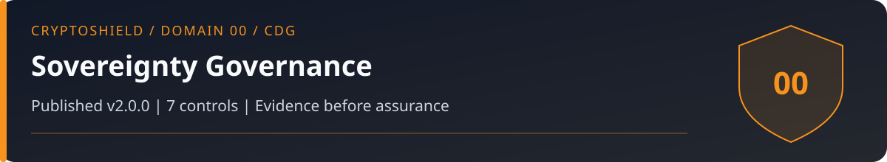

# Domain 00: Cross-Domain Sovereignty Governance (CDG)

<!-- domain-overview:start -->

   

[Home](../README.md) | [All pages](../REPOSITORY-MAP.md) | [Domains](../README.md#domains-and-control-counts) | [v2.0 changes](../FRAMEWORK-UPDATE.md) | [Machine-readable index](../metadata/repository-index.json) | [Automation guide](../AUTOMATION.md)

## Review this domain

- Apply the controls below, then record evidence in the [self-assessment](../tools/sovereignty-self-assessment.md).
- Respond using the [policy custody event playbook](../playbooks/policy-custody-event.md); read the [related research note](../research/007_false_flag_forensics.md).
- Trace threat definitions in the [taxonomy](../taxonomy/README.md), cases in the [intelligence library](../intelligence/README.md), and practice in the [tabletop exercises](../tools/tabletop-exercises.md).

### Control changes in v2.0.0

NEW identifies added IDs. UPDATED identifies material revisions listed in the [framework comparison](../FRAMEWORK-UPDATE.md). RETAINED identifies an existing ID outside that material-update list; it does not mean the wording is unchanged or the control has been tested. Colors repeat the written labels.

| Control | v2.0 status |
|---|---|
| CDG-01 |  |
| CDG-02 |  |
| CDG-03 |  |
| CDG-04 |  |
| CDG-05 |  |
| CDG-06 |  |
| CDG-07 |  |
<!-- domain-overview:end -->

CSI CryptoSHIELD 2.0.0 | Integrity review: November 7, 2026

CSI favors individual control of assets, privacy, and accountable governance. These are policy commitments. They do not establish legal rights in every jurisdiction or override applicable obligations.

## Controls

| Control ID | Control | Priority |
|---|---|---|
| CDG-01 | Sovereignty-First Policy Declaration: explicit written commitment to self-custody as the default | CRITICAL |
| CDG-02 | U.S. Constitutional Alignment Protocol: framework review against applicable court rulings quarterly | HIGH |
| CDG-03 | CBDC Non-Adoption Commitment: documented organizational policy against CBDC participation | CRITICAL |
| CDG-04 | Self-Custody Rights Documentation: maintain documented record of self-custody rights per jurisdiction | HIGH |
| CDG-05 | Annual Sovereignty Architecture Review: annual comprehensive review of all framework controls against updated threat and regulatory landscape | HIGH |
| CDG-06 | Evidence provenance and claim lifecycle | HIGH |
| CDG-07 | Versioned assessment and compatibility governance | HIGH |

## Governance evidence

CDG-01 records custody policy, exceptions, accountable owners, and recovery needs. CDG-02 and CDG-04 maintain a dated legal-source register per jurisdiction, entity, activity, and asset. CDG-03 records CSI's non-adoption policy as a policy choice, not a legal conclusion. CDG-05 reviews control evidence and unresolved exceptions annually and after material change.

Use [Domain 08](../08-governance-compliance-sovereignty/README.md) for legal-source handling. No current constitutional or statutory conclusion follows from this domain's policy alignment.

## New controls in 2.0.0

### CDG-06: Evidence provenance and claim lifecycle

Finding: Unsupported incident, loss, attribution, and efficacy claims lack reproducible provenance.

Requirement: Maintain a claim register with exact wording, primary artifacts, event/publication/review dates, population, method, contrary evidence, accountable reviewer, and status. Keep publisher assertions, observations, hypotheses, and tested outcomes distinct. Revalidate after material source changes; withdraw unsupported claims from active guidance while retaining their history.

Acceptance: A reviewer can reproduce each accepted claim from its artifacts. Missing or contradictory evidence leaves the claim pending; two articles repeating one disclosure are one evidence chain.

### CDG-07: Versioned assessment and compatibility governance

Finding: Conflicting CTRS models, ranges, schemas, and tables produce incompatible decisions.

Requirement: Assign an owner and immutable version to each model and data contract. Specify inputs, ranges, units, scaling, rounding, uncertainty, applicability, and migration. Require independent review and executable boundary fixtures before adoption. Composite CTRS remains suspended until these requirements and calibration are met.

Acceptance: Reject missing model versions, out-of-range inputs, incompatible consumers, and unpublished formula changes. Reproduce historical records without silently recalculating them.

These are control specifications, not deployed protections. The [review and evidence backlog](../reviews/2026-11-07-baseline-integrity.md) records verification limits. Historical artwork is retired from active guidance; see the [asset register](../assets/README.md).
