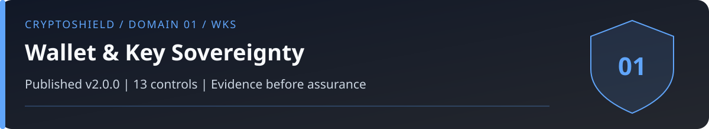

# Domain 01: Wallet and Key Sovereignty (WKS)

<!-- domain-overview:start -->

   

[Home](../README.md) | [All pages](../REPOSITORY-MAP.md) | [Domains](../README.md#domains-and-control-counts) | [v2.0 changes](../FRAMEWORK-UPDATE.md) | [Machine-readable index](../metadata/repository-index.json) | [Automation guide](../AUTOMATION.md)

## Review this domain

- Apply the controls below, then record evidence in the [self-assessment](../tools/sovereignty-self-assessment.md).
- Respond using the [wallet compromise playbook](../playbooks/wallet-compromise.md); read the [related research note](../research/005_supply_chain_vectors.md).
- Trace threat definitions in the [taxonomy](../taxonomy/README.md), cases in the [intelligence library](../intelligence/README.md), and practice in the [tabletop exercises](../tools/tabletop-exercises.md).

### Control changes in v2.0.0

NEW identifies added IDs. UPDATED identifies material revisions listed in the [framework comparison](../FRAMEWORK-UPDATE.md). RETAINED identifies an existing ID outside that material-update list; it does not mean the wording is unchanged or the control has been tested. Colors repeat the written labels.

| Control | v2.0 status |
|---|---|
| WKS-01 |  |
| WKS-02 |  |
| WKS-03 |  |
| WKS-04 |  |
| WKS-05 |  |
| WKS-06 |  |
| WKS-07 |  |
| WKS-08 |  |
| WKS-09 |  |
| WKS-10 |  |
| WKS-11 |  |
| WKS-12 |  |
| WKS-13 |  |
<!-- domain-overview:end -->

CSI CryptoSHIELD 2.0.0 | Integrity review: November 7, 2026

Protect keys, verify what is signed, and inventory every authority that can move assets. An uncompromised key does not prevent misuse of a valid approval, compromised delegate, or unsafe contract.

## Controls

| Control ID | Control | Priority |
|---|---|---|
| WKS-01 | Hardware wallet and device-integrity review | CRITICAL |
| WKS-02 | Multisig with Geographic Diversity | CRITICAL |
| WKS-03 | Tiered Timelock on Governance Transactions | CRITICAL |
| WKS-04 | Seed Phrase Offline Sovereignty | CRITICAL |
| WKS-05 | No Blind Signing | CRITICAL |
| WKS-06 | Independent Address Verification Protocol | HIGH |
| WKS-07 | Token Approval Revocation Protocol | HIGH |
| WKS-08 | Permit Scam Recognition | HIGH |
| WKS-09 | Cold storage and total accessible exposure | CRITICAL |
| WKS-10 | Watch-Only Wallet for Household Members | HIGH |
| WKS-11 | Financial authority inventory | CRITICAL |
| WKS-12 | Authority revocation and recovery verification | CRITICAL |
| WKS-13 | Hardware procurement and whole-device trust | HIGH |

## Wallet implementation boundaries

WKS-01: Buy through an authenticated manufacturer channel. Initialize fresh recovery material on the device and follow its supported authenticity checks. Never accept a supplied seed. Distinguish procurement provenance, firmware signature, secure-element attestation where available, and whole-device integrity. No single check establishes all four. PIN capabilities and key-storage designs vary by device.

WKS-02: Separate signing devices, locations, operators, communication channels, and recovery paths. Inventory owners, threshold, modules, delegates, session keys, and emergency authorities. Geographic separation alone does not establish independent trust.

WKS-03: Apply audited delays to specified governance paths. The historical 72-hour, 7-day, and 14-day thresholds are planning defaults, not validated efficacy thresholds. Verify queue monitoring, cancellation, and all upgrade or bypass paths. A governance timelock does not delay ordinary wallet transfers or already-granted spending authority. Emergency powers may pause or cancel within a bounded scope; they must not silently permit arbitrary transfers or upgrades.

WKS-04: Generate recovery material on a trusted device and keep it offline with controlled physical access. Use only a supported, tested threshold-backup scheme rather than manually splitting words. Verify recovery on trusted hardware before migration. Recovery may legitimately require seed entry into the device itself. Never enter it into a website, chat, unsolicited app, or ordinary computer form.

WKS-05 and WKS-06: Bind review to the exact chain, account, contract, function, calldata, value, nonce, and resulting permissions. Verify the complete recipient on an independent trusted display. A compromised device or firmware remains a risk. Inspect batches, upgrades, modules, delegatecalls, and approvals, not just transfer amounts.

WKS-07 and WKS-08: Inventory ERC-20 allowances, NFT operator grants, permits, Permit2 permissions, smart-account modules, delegates, sessions, signing services, and recovery authority on every chain used. Record principal, scope, limits, expiry, revocation method, owner, and test evidence. Off-chain signatures may not appear in an allowance viewer. Ordinary allowance revocation may not invalidate an unused permit. Use the mechanism's supported nonce, expiry, lockdown, or authority-removal path and verify the result.

WKS-09: Set an explicit exposure budget for hot wallets, approvals, delegated authority, open positions, bridges, and custody. The historical 90/10 allocation is a planning heuristic. It bounds loss only if every accessible authority is inside that allocation; cold balances with live approvals may remain exposed.

WKS-10: Watch-only access avoids granting signing authority but can expose balances and relationships. Preserve a documented, tested estate and recovery process for authorized successors. Limited knowledge does not prevent threats against family members.

## Verification

Test setup and recovery with non-production funds. Demonstrate that a compromised ordinary signer cannot bypass threshold, delay, revocation, or recovery boundaries. Record unsupported paths and residual exposure. For an active incident, use the [wallet decision tree](../playbooks/wallet-compromise.md).

## New controls in 2.0.0

### WKS-11: Financial authority inventory

Finding: Key inventories omit approvals, permits, modules, delegates, sessions, signers, and recovery powers.

Requirement: Inventory every principal and path that can transfer, approve, freeze, upgrade, redeem, or recover assets, including ERC-20/NFT grants, unused permits, Permit2, smart-account modules, session keys, signing APIs, and recovery administrators. Record chains, accounts, assets, scope, limits, expiry, owner, dependencies, and invalidation mechanism. Review monthly and after authority changes.

Acceptance: Reconcile the inventory against deployed configuration and observed grants. A deliberately added module or unused permit must be found; unknown authority prevents declaring the account fully assessed.

### WKS-12: Authority revocation and recovery verification

Finding: Revoking an allowance or stopping an app can leave keys, signatures, or delegates active.

Requirement: Specify a supported invalidation and recovery procedure for each WKS-11 authority. Distinguish seed migration, allowance removal, permit nonce/expiry handling, module/session removal, credential rotation, and recovery-role changes. Verify the resulting chain state and pending signatures. Preserve recovery evidence; use the wallet decision tree for sweeper and gas races.

Acceptance: After revocation, attempts through each removed path fail under its documented semantics. Test unused signatures, a pending request, alternate chains, and compromised recovery credentials. Record paths that cannot be invalidated immediately.

### WKS-13: Hardware procurement and whole-device trust

Finding: Authentic firmware or a secure element does not establish whole-device integrity.

Requirement: Authenticate the procurement channel and supported device/firmware checks; initialize fresh recovery material on trusted hardware. Record what each attestation covers and excludes, including display, input, enclosure, firmware, and key storage. Reject pre-generated recovery material or untrusted setup instructions. Do not treat manufacturer-direct purchase as a complete integrity test.

Acceptance: Document the result and coverage of each supported check. A genuine component with an unassessed display or altered setup process cannot pass a claim of whole-device integrity.

These are control specifications, not deployed protections. The [review and evidence backlog](../reviews/2026-11-07-baseline-integrity.md) records verification limits. Historical artwork is retired from active guidance; see the [asset register](../assets/README.md).
