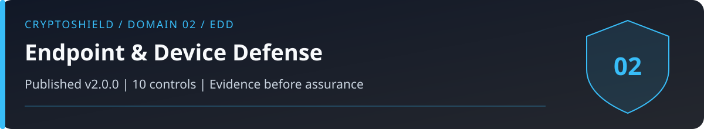

# Domain 02: Endpoint and Device Defense (EDD)

<!-- domain-overview:start -->

   

[Home](../README.md) | [All pages](../REPOSITORY-MAP.md) | [Domains](../README.md#domains-and-control-counts) | [v2.0 changes](../FRAMEWORK-UPDATE.md) | [Machine-readable index](../metadata/repository-index.json) | [Automation guide](../AUTOMATION.md)

## Review this domain

- Apply the controls below, then record evidence in the [self-assessment](../tools/sovereignty-self-assessment.md).
- Respond using the [endpoint supply chain playbook](../playbooks/endpoint-supply-chain.md); read the [related research note](../research/005_supply_chain_vectors.md).
- Trace threat definitions in the [taxonomy](../taxonomy/README.md), cases in the [intelligence library](../intelligence/README.md), and practice in the [tabletop exercises](../tools/tabletop-exercises.md).

### Control changes in v2.0.0

NEW identifies added IDs. UPDATED identifies material revisions listed in the [framework comparison](../FRAMEWORK-UPDATE.md). RETAINED identifies an existing ID outside that material-update list; it does not mean the wording is unchanged or the control has been tested. Colors repeat the written labels.

| Control | v2.0 status |
|---|---|
| EDD-01 |  |
| EDD-02 |  |
| EDD-03 |  |
| EDD-04 |  |
| EDD-05 |  |
| EDD-06 |  |
| EDD-07 |  |
| EDD-08 |  |
| EDD-09 |  |
| EDD-10 |  |
<!-- domain-overview:end -->

CSI CryptoSHIELD 2.0.0 | Integrity review: November 7, 2026

Default-deny execution policy, containment, signing isolation, patching, and detection address different failure paths. Blocking unknown code and allowing isolated execution are different modes. Document which mode each application uses.

## Controls

| Control ID | Control | Priority |
|---|---|---|
| EDD-01 | Kernel-Level Default-Deny Endpoint Protection | CRITICAL |
| EDD-02 | Dedicated Signing Device | CRITICAL |
| EDD-03 | Verified Software and SBOM for Developers | CRITICAL |
| EDD-04 | Anti-Clipboard-Hijack Protocol | CRITICAL |
| EDD-05 | Browser Extension Minimization | HIGH |
| EDD-06 | Operating System Hardening | HIGH |
| EDD-07 | EDR as Supplemental Detection Layer | MEDIUM |
| EDD-08 | Network Isolation for Signing Operations | HIGH |
| EDD-09 | Physical Security of Signing Device | HIGH |
| EDD-10 | Application Allowlisting | CRITICAL |

## Implementation and verification

EDD-01: Define the execution and containment boundary for binaries, scripts, interpreters, browser code, extensions, dependencies, and trusted applications. Deny unapproved host access. Test policy failure, allowed-application abuse, privileged compromise, and containment escape assumptions. Logical containment is not physical isolation. This repository contains no endpoint implementation or product efficacy test.

EDD-02: Separate routine browsing and development from signing. Review transactions on a different trusted path from the one that constructed them. Shared accounts, recovery credentials, networks, and update channels can defeat device separation.

EDD-03: Verify software origin and artifact identity, maintain an SBOM for development, and review update provenance. An inventory or code signature is not a malware verdict.

EDD-04: Verify the entire recipient address against an independently obtained intended address. Prefix and suffix checks cannot defeat lookalike addresses.

EDD-05 and EDD-06: Minimize extensions and services, patch supported software, encrypt storage, and test backups. Review extension updates and permissions. A separate browser profile provides less isolation than a separate device.

EDD-07: Retain endpoint detection, logs, and incident response alongside preventive controls. Do not assume another layer always succeeds.

EDD-08: Restrict network access to required destinations and document offline-signing paths. VPNs shift trust to their operator; they do not make a compromised endpoint or malicious HTTPS service safe.

EDD-09: Protect hardware and recovery materials against theft and tampering while preserving safe recovery. EDD-10: Enforce application policy for scripts and interpreters as well as executables. Signed malicious code and trusted-application abuse remain possible.

Record platform, product, version, policy, test payload, expected denial, actual result, and bypasses before claiming protection. No percentage of historical incidents prevented is established here.

These are control specifications, not deployed protections. The [review and evidence backlog](../reviews/2026-11-07-baseline-integrity.md) records verification limits. Historical artwork is retired from active guidance; see the [asset register](../assets/README.md).
