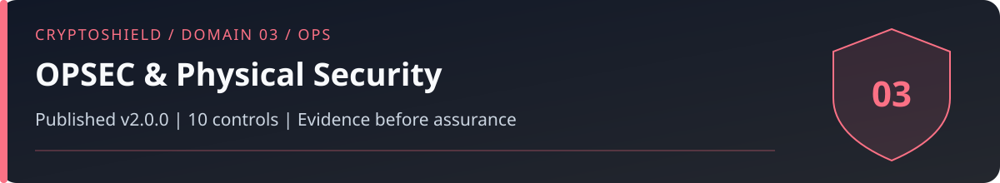

# Domain 03: OPSEC and Physical Security (OPS)

<!-- domain-overview:start -->

   

[Home](../README.md) | [All pages](../REPOSITORY-MAP.md) | [Domains](../README.md#domains-and-control-counts) | [v2.0 changes](../FRAMEWORK-UPDATE.md) | [Machine-readable index](../metadata/repository-index.json) | [Automation guide](../AUTOMATION.md)

## Review this domain

- Apply the controls below, then record evidence in the [self-assessment](../tools/sovereignty-self-assessment.md).
- Respond using the [physical coercion playbook](../playbooks/physical-coercion.md); read the [related research note](../research/001_wrench_attack_epidemic.md).
- Trace threat definitions in the [taxonomy](../taxonomy/README.md), cases in the [intelligence library](../intelligence/README.md), and practice in the [tabletop exercises](../tools/tabletop-exercises.md).

### Control changes in v2.0.0

NEW identifies added IDs. UPDATED identifies material revisions listed in the [framework comparison](../FRAMEWORK-UPDATE.md). RETAINED identifies an existing ID outside that material-update list; it does not mean the wording is unchanged or the control has been tested. Colors repeat the written labels.

| Control | v2.0 status |
|---|---|
| OPS-01 |  |
| OPS-02 |  |
| OPS-03 |  |
| OPS-04 |  |
| OPS-05 |  |
| OPS-06 |  |
| OPS-07 |  |
| OPS-08 |  |
| OPS-09 |  |
| OPS-10 |  |
<!-- domain-overview:end -->

CSI CryptoSHIELD 2.0.0 | Integrity review: November 7, 2026

Physical safety takes priority over assets. Reduce public exposure and plan with trusted contacts before a crisis. Multisig and delays constrain some transfers; they cannot guarantee safety or prevent prolonged coercion.

## Controls

| Control ID | Control | Priority |
|---|---|---|
| OPS-01 | Zero Public Disclosure of Holdings | CRITICAL |
| OPS-02 | Decouple Identity from On-Chain | CRITICAL |
| OPS-03 | Chain-aware address privacy | HIGH |
| OPS-04 | OSINT Self-Audit | HIGH |
| OPS-05 | Physical Incident Response Plan | CRITICAL |
| OPS-06 | Optional decoy risk assessment | HIGH |
| OPS-07 | Family OPSEC | CRITICAL |
| OPS-08 | Geolocation Hygiene | HIGH |
| OPS-09 | Surveillance Detection | MEDIUM |
| OPS-10 | Duress Protocol | HIGH |

## Life-safety planning

OPS-01 and OPS-02 reduce disclosure and identity linkage; breaches, public records, and transaction analysis remain possible sources of exposure. OPS-03 uses chain-appropriate receiving practices. Fresh addresses do not guarantee unlinkability, especially when funded from the same account or used with public contracts.

OPS-04 reviews exposed addresses, photos, public records, and account data quarterly. OPS-05 records emergency contacts, safe communication, medical needs, and family plans. During an incident, do not delay seeking safety to finish controls or collect evidence.

OPS-06 is optional. Decoys and deception can escalate violence. Do not assume a balance will satisfy an attacker, invent hardware limitations, or require refusal to disclose access. Decide any pre-incident use with qualified physical-security advice. Declining a decoy must not reduce an assessment score.

OPS-07 balances family privacy with informed consent, emergency support, and estate access. OPS-08 reduces location exposure. OPS-09 calls for safe documentation and professional help rather than confrontation. OPS-10 uses a pre-agreed signal only when safe; test it without triggering an actual emergency response.

Follow the [physical-coercion playbook](../playbooks/physical-coercion.md). Architecture can constrain access but cannot guarantee a maximum loss, an attacker's behavior, or physical safety.

These are control specifications, not deployed protections. The [review and evidence backlog](../reviews/2026-11-07-baseline-integrity.md) records verification limits. Historical artwork is retired from active guidance; see the [asset register](../assets/README.md).
