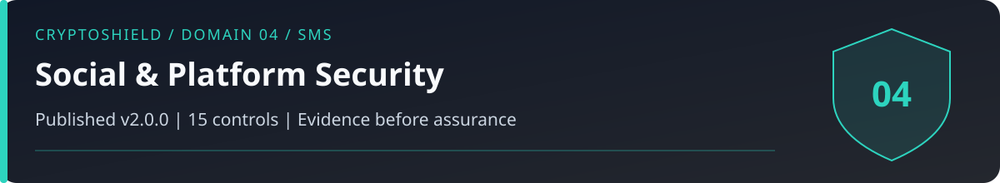

# Domain 04: Social Media and Platform Security (SMS)

<!-- domain-overview:start -->

   

[Home](../README.md) | [All pages](../REPOSITORY-MAP.md) | [Domains](../README.md#domains-and-control-counts) | [v2.0 changes](../FRAMEWORK-UPDATE.md) | [Machine-readable index](../metadata/repository-index.json) | [Automation guide](../AUTOMATION.md)

## Review this domain

- Apply the controls below, then record evidence in the [self-assessment](../tools/sovereignty-self-assessment.md).
- Respond using the [account takeover playbook](../playbooks/account-takeover.md); read the [related research note](../research/006_pig_butchering_anatomy.md).
- Trace threat definitions in the [taxonomy](../taxonomy/README.md), cases in the [intelligence library](../intelligence/README.md), and practice in the [tabletop exercises](../tools/tabletop-exercises.md).

### Control changes in v2.0.0

NEW identifies added IDs. UPDATED identifies material revisions listed in the [framework comparison](../FRAMEWORK-UPDATE.md). RETAINED identifies an existing ID outside that material-update list; it does not mean the wording is unchanged or the control has been tested. Colors repeat the written labels.

| Control | v2.0 status |
|---|---|
| SMS-01 |  |
| SMS-02 |  |
| SMS-03 |  |
| SMS-04 |  |
| SMS-05 |  |
| SMS-06 |  |
| SMS-07 |  |
| SMS-08 |  |
| SMS-09 |  |
| SMS-10 |  |
| SMS-11 |  |
| SMS-12 |  |
| SMS-13 |  |
| SMS-14 |  |
| SMS-15 |  |
<!-- domain-overview:end -->

CSI CryptoSHIELD 2.0.0 | Integrity review: November 7, 2026

Verify identities, destinations, permissions, and recovery paths independently. A correct URL, HTTPS connection, paid verification badge, clean scam-database search, or plausible video does not establish safety.

## Controls

| Control ID | Control | Priority |
|---|---|---|
| SMS-01 | Phishing-resistant authentication where supported | CRITICAL |
| SMS-02 | Reduce phone-based recovery exposure | CRITICAL |
| SMS-03 | OAuth Audit | HIGH |
| SMS-04 | Dedicated Recovery Email | HIGH |
| SMS-05 | URL Verification | CRITICAL |
| SMS-06 | No Unsolicited DM Trust | CRITICAL |
| SMS-07 | Social Engineering Drill | HIGH |
| SMS-08 | Official Channel Verification | HIGH |
| SMS-09 | DNS/Frontend Alert System | HIGH |
| SMS-10 | Influencer Skepticism Protocol | MEDIUM |
| SMS-11 | Manual URL Entry Protocol | HIGH |
| SMS-12 | Pre-Transaction Platform Verification | CRITICAL |
| SMS-13 | 10-Day Rule for New Platforms | HIGH |
| SMS-14 | Independently verify withdrawal fee demands | CRITICAL |
| SMS-15 | Recovery scam awareness | CRITICAL |

## Account and platform verification

SMS-01: Use phishing-resistant authentication where supported, with a tested independent recovery path. Platform capabilities differ. SMS-02: Remove optional phone recovery after testing alternatives. Hiding a phone number does not remove it as an authentication dependency.

SMS-03 audits OAuth grants, active sessions, devices, API keys, and recovery methods. Changing a password may not revoke existing sessions or third-party grants. SMS-04 separates recovery email from public contact addresses.

SMS-05 and SMS-11 use independently verified bookmarks or addresses and inspect complete hostnames. DNS, hosting, dependencies, or the official frontend may still be compromised. SMS-06 independently verifies unsolicited contact. SMS-07 tests response habits without using live funds. SMS-08 compares announcements with authenticated governance and support paths.

SMS-09 treats phishing alerts as supplemental evidence. SMS-10 examines allocations, incentives, and disclosures; synchronized opinions do not prove coordination. SMS-12 records database and registration checks as no-report-found, flagged, or unresolved. Absence from a complaint database is not clearance.

SMS-13 uses the historical ten-day wait as a cooling-off policy, not a fraud test or permission to deposit afterward. SMS-14 pauses new payments when surprise taxes, deposits, or upgrades are demanded to release funds. Verify independently against published terms. Ordinary disclosed fees and network gas are different mechanisms. Do not pay a suspicious unlock demand.

SMS-15 distinguishes recovery fraud from lawful tracing, freezes, seizure, restitution, or voluntary return. No provider can guarantee recovery. Independently check identity, authority, scope, and fees. Video gestures, a familiar voice, and a callback to an attacker-supplied number do not establish identity.

These are control specifications, not deployed protections. The [review and evidence backlog](../reviews/2026-11-07-baseline-integrity.md) records verification limits. Historical artwork is retired from active guidance; see the [asset register](../assets/README.md).
