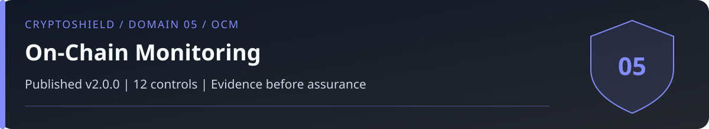

# Domain 05: On-Chain Monitoring and Transaction Defense (OCM)

<!-- domain-overview:start -->

   

[Home](../README.md) | [All pages](../REPOSITORY-MAP.md) | [Domains](../README.md#domains-and-control-counts) | [v2.0 changes](../FRAMEWORK-UPDATE.md) | [Machine-readable index](../metadata/repository-index.json) | [Automation guide](../AUTOMATION.md)

## Review this domain

- Apply the controls below, then record evidence in the [self-assessment](../tools/sovereignty-self-assessment.md).
- Respond using the [protocol exploit playbook](../playbooks/protocol-exploit.md); read the [related research note](../research/002_rotator_effect.md).
- Trace threat definitions in the [taxonomy](../taxonomy/README.md), cases in the [intelligence library](../intelligence/README.md), and practice in the [tabletop exercises](../tools/tabletop-exercises.md).

### Control changes in v2.0.0

NEW identifies added IDs. UPDATED identifies material revisions listed in the [framework comparison](../FRAMEWORK-UPDATE.md). RETAINED identifies an existing ID outside that material-update list; it does not mean the wording is unchanged or the control has been tested. Colors repeat the written labels.

| Control | v2.0 status |
|---|---|
| OCM-01 |  |
| OCM-02 |  |
| OCM-03 |  |
| OCM-04 |  |
| OCM-05 |  |
| OCM-06 |  |
| OCM-07 |  |
| OCM-08 |  |
| OCM-09 |  |
| OCM-10 |  |
| OCM-11 |  |
| OCM-12 |  |
<!-- domain-overview:end -->

CSI CryptoSHIELD 2.0.0 | Integrity review: November 7, 2026

Verify transaction intent and resulting authority before signing; monitor afterward. Simulation observes a particular state and payload. Finality does not prevent every form of restitution, seizure, issuer freeze, or negotiated return.

## Controls

| Control ID | Control | Priority |
|---|---|---|
| OCM-01 | Transaction Simulation | CRITICAL |
| OCM-02 | Real-Time Wallet Monitor | HIGH |
| OCM-03 | Authority monitoring and revocation | HIGH |
| OCM-04 | Mempool Awareness | HIGH |
| OCM-05 | MEV Protection | MEDIUM |
| OCM-06 | Address Poisoning Detection | HIGH |
| OCM-07 | Bridge verification and backing assessment | HIGH |
| OCM-08 | Smart Contract Audit Verification | HIGH |
| OCM-09 | Anomaly Detection | HIGH |
| OCM-10 | Permit/Signature Intelligence | CRITICAL |
| OCM-11 | Aggregate exposure budget enforcement | CRITICAL |
| OCM-12 | Bridge backing and redemption invariants | CRITICAL |

## Transaction and authority checks

OCM-01 binds simulation and decoding to the exact payload signed, chain state, contract implementation, and resulting permissions. Check chain, account, nonce, recipient, calldata, value, batch actions, and authority changes independently. Simulation can miss state changes, upgrade behavior, delayed actions, and off-chain signatures. Fail closed when required verification is unavailable.

OCM-02 tests alerts and escalation with safe transactions. An alert does not reverse execution. On suspected compromise, use the [wallet decision tree](../playbooks/wallet-compromise.md), not a universal revoke-and-move sequence.

OCM-03 inventories all spending and delegation authority with WKS-07. Review at least monthly and after a relevant incident or change. Automatic revocation requires explicitly authorized signing capability; a monitor alone cannot revoke. Off-chain signatures and non-ERC-20 authorities require their own invalidation paths.

OCM-04 and OCM-05 assess chain-supported private submission and MEV controls. Private RPC providers and builders remain trust dependencies. Private submission does not remove key compromise or guarantee a rescue.

OCM-06 verifies the complete address independently. OCM-07 uses the [bridge appendix](../taxonomy/bridge-risk-appendix.md), including backing and redemption. Validator counts, audits, age, TVL, and a canonical label cannot establish safety.

OCM-08 matches audit scope and deployed bytecode, dependencies, upgrade authority, unresolved findings, and changes since review. An audit is not an endorsement. OCM-09 records monitoring coverage and false negatives. OCM-10 decodes typed data, domain, chain ID, verifying contract, spender, value, nonce, and expiry. Reject opaque signatures. EIP-712 formatting does not establish benign intent.

## New controls in 2.0.0

### OCM-11: Aggregate exposure budget enforcement

Finding: Per-wallet balances and transaction-count limits do not bound principal-wide financial exposure.

Requirement: Own one exposure policy across wallets, agents, sessions, chains, bridges, open obligations, and pending actions. Define valuation, conservative treatment of unknown assets, stale-data/outage behavior, rolling windows, atomic reservations, settlement, expiry, and retry idempotency. Enforce at every inventoried execution path; budget or valuation unavailability fails closed for new exposure.

Acceptance: Two concurrent requests that are individually allowed but exceed the combined budget cannot both succeed. Test wallet splitting, replenishment, retries, bridge routes, pending reservations, stale prices, and policy outages.

### OCM-12: Bridge backing and redemption invariants

Finding: A valid cross-chain message can still create an unbacked or nonredeemable claim.

Requirement: Assess message authenticity separately from economic backing. Reconcile locked assets, minted/burned claims, liabilities, finality, custody, issuer powers, and redemption rights for each route and asset. Monitor discrepancies and block new exposure when defined backing or redemption invariants fail. Include upgrade and emergency paths in the assessment.

Acceptance: A correctly authenticated message that mints beyond supported backing must fail the exposure gate. Test replay, conflicting finality, collateral shortfall, unavailable redemption, and a malicious upgrade. Do not infer solvency from a reserve snapshot.

These are control specifications, not deployed protections. The [review and evidence backlog](../reviews/2026-11-07-baseline-integrity.md) records verification limits. Historical artwork is retired from active guidance; see the [asset register](../assets/README.md).
