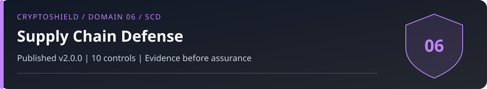

# Domain 06: Supply Chain Defense (SCD)

<!-- domain-overview:start -->


[](../CHANGELOG.md) [](#controls) [](../FRAMEWORK-UPDATE.md#added-controls) [](../FRAMEWORK-UPDATE.md#material-updates-to-existing-controls)

[Home](../README.md) | [All pages](../REPOSITORY-MAP.md) | [Domains](../README.md#domains-and-control-counts) | [v2.0 changes](../FRAMEWORK-UPDATE.md) | [Machine-readable index](../metadata/repository-index.json) | [Automation guide](../AUTOMATION.md)

## Review this domain

- Apply the controls below, then record evidence in the [self-assessment](../tools/sovereignty-self-assessment.md).
- Respond using the [endpoint supply chain playbook](../playbooks/endpoint-supply-chain.md); read the [related research note](../research/005_supply_chain_vectors.md).
- Trace threat definitions in the [taxonomy](../taxonomy/README.md), cases in the [intelligence library](../intelligence/README.md), and practice in the [tabletop exercises](../tools/tabletop-exercises.md).

### Control changes in v2.0.0

NEW identifies added IDs. UPDATED identifies material revisions listed in the [framework comparison](../FRAMEWORK-UPDATE.md). RETAINED identifies an existing ID outside that material-update list; it does not mean the wording is unchanged or the control has been tested. Colors repeat the written labels.

| Control | v2.0 status |
|---|---|
| SCD-01 |  |
| SCD-02 |  |
| SCD-03 |  |
| SCD-04 |  |
| SCD-05 |  |
| SCD-06 |  |
| SCD-07 |  |
| SCD-08 |  |
| SCD-09 |  |
| SCD-10 |  |
<!-- domain-overview:end -->

CSI CryptoSHIELD 2.0.0 | Integrity review: November 7, 2026

Inventory dependencies, authenticate artifacts, isolate build credentials, and review changes. A signature or hash establishes a relationship to an expected artifact or signer. It does not establish that the code is safe.

## Controls

| Control ID | Control | Priority |
|---|---|---|
| SCD-01 | SBOM Enforcement | CRITICAL |
| SCD-02 | Dependency Allowlisting | CRITICAL |
| SCD-03 | CI/CD Secret Isolation | CRITICAL |
| SCD-04 | Binary Analysis | HIGH |
| SCD-05 | Third-Party Risk Assessment | HIGH |
| SCD-06 | Adversarial Supply Chain Simulation | HIGH |
| SCD-07 | Package Lock Pinning | CRITICAL |
| SCD-08 | AI Model Provenance | HIGH |
| SCD-09 | Post-Install Hook Blocking | HIGH |
| SCD-10 | Critical Release Exam | HIGH |

## Supply-chain implementation

SCD-01 generates and reviews an SBOM for each release. SCD-02 records an allowlist of package identities, exact versions, integrity hashes, and provenance expectations. SCD-07 commits the lockfile and installs from it. Pinning preserves a chosen version, including a malicious one; upgrades still require review.

For a reviewed Node dependency set, use the supported commands below. Install steps are examples for an isolated build environment, not instructions to run untrusted projects on a signing machine.

```sh
npm ci --ignore-scripts
npm audit signatures
```

[`npm audit signatures`](https://docs.npmjs.com/cli/v11/commands/npm-audit/) verifies available signatures and provenance attestations. Define how missing attestations are handled; the command is not a universal provenance-required policy or safety verdict. The prior `--require-provenance` installation example was removed.

SCD-03 keeps production signing keys outside build jobs, uses short-lived scoped credentials, and separates build from deployment approval. Masking a secret in logs does not stop a malicious job from stealing it. SCD-04 compares and scans produced artifacts. SCD-05 reviews supplier access, update channels, and incident response. SCD-06 exercises maintainer compromise, malicious build steps, and artifact substitution without production secrets.

SCD-08 verifies model and package provenance before loading, including the loader and serialization format. A published digest does not prove model behavior. Treat install-package compromise and model-weight backdoors as separate claims.

SCD-09 blocks lifecycle scripts by default in an isolated build. A user-level configuration does not govern all users or resist command-line overrides. Review any required build step and its transitive execution in a disposable environment without production credentials; do not globally re-enable scripts as a package exception. SCD-10 reviews code, artifacts, permissions, and rollback before deployment.

Record exact tool versions and commands, upstream source, artifact digest, review decisions, tests, and exceptions. No current incident count or prevention percentage is established by this domain.


These are control specifications, not deployed protections. The [review and evidence backlog](../reviews/2026-11-07-baseline-integrity.md) records verification limits. Historical artwork is retired from active guidance; see the [asset register](../assets/README.md).
