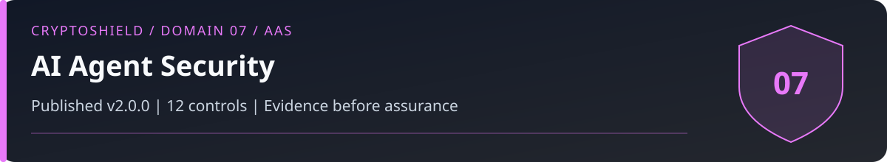

# Domain 07: AI Agent and Autonomous System Security (AAS)

<!-- domain-overview:start -->

   

[Home](../README.md) | [All pages](../REPOSITORY-MAP.md) | [Domains](../README.md#domains-and-control-counts) | [v2.0 changes](../FRAMEWORK-UPDATE.md) | [Machine-readable index](../metadata/repository-index.json) | [Automation guide](../AUTOMATION.md)

## Review this domain

- Apply the controls below, then record evidence in the [self-assessment](../tools/sovereignty-self-assessment.md).
- Respond using the [ai agent compromise playbook](../playbooks/ai-agent-compromise.md); read the [related research note](../research/004_ai_agent_attack_surface.md).
- Trace threat definitions in the [taxonomy](../taxonomy/README.md), cases in the [intelligence library](../intelligence/README.md), and practice in the [tabletop exercises](../tools/tabletop-exercises.md).

### Control changes in v2.0.0

NEW identifies added IDs. UPDATED identifies material revisions listed in the [framework comparison](../FRAMEWORK-UPDATE.md). RETAINED identifies an existing ID outside that material-update list; it does not mean the wording is unchanged or the control has been tested. Colors repeat the written labels.

| Control | v2.0 status |
|---|---|
| AAS-01 |  |
| AAS-02 |  |
| AAS-03 |  |
| AAS-04 |  |
| AAS-05 |  |
| AAS-06 |  |
| AAS-07 |  |
| AAS-08 |  |
| AAS-09 |  |
| AAS-10 |  |
| AAS-11 |  |
| AAS-12 |  |
<!-- domain-overview:end -->

CSI CryptoSHIELD 2.0.0 | Integrity review: November 7, 2026

An agent without a private key can still cause a signing service to move funds. Enforce financial authority outside the model and outside attacker-controlled prompts, memory, and tools.

## Controls

| Control ID | Control | Priority |
|---|---|---|
| AAS-01 | Separate agent decisions from signing authority | CRITICAL |
| AAS-02 | Memory provenance and integrity | CRITICAL |
| AAS-03 | Prompt injection containment | CRITICAL |
| AAS-04 | Agent wallet isolation: minimal-balance dedicated wallets per strategy | HIGH |
| AAS-05 | Testnet simulation first: no mainnet deployment without sandbox validation | HIGH |
| AAS-06 | Aggregate financial exposure limits | CRITICAL |
| AAS-07 | Real-time agent behavior anomaly detection | HIGH |
| AAS-08 | Tool call allowlisting: permitted smart contracts and endpoints only | CRITICAL |
| AAS-09 | Independent oracle inputs and outage policy | HIGH |
| AAS-10 | Swarm isolation and shared exposure limits | HIGH |
| AAS-11 | Independent human financial authorization | CRITICAL |
| AAS-12 | Agent shutdown and persistent-authority containment | CRITICAL |

## Enforceable financial authority

AAS-01: Put signing and policy enforcement outside the agent's runtime and credentials. Authenticate the caller and bind each authorization to chain, account, target, calldata, asset, amount, nonce, expiry, and policy version. A remote signer that accepts every agent request provides no financial separation.

AAS-02: Authenticate memory sources, track changes, and review poisoned content. Hashing poisoned content does not make it trustworthy. AAS-03: Treat retrieved text and model output as untrusted. Prompt wording alone cannot enforce permission boundaries.

AAS-04: Isolate wallets and strategies while tracking their combined exposure. AAS-05: Test the exact policy and failure paths before deployment; testnet success does not establish mainnet economics or safety.

AAS-06: Apply the shared OCM-11 exposure policy at each agent authorization gate. Aggregate wallets, sessions, chains, retries, bridges, pending actions, and concurrent requests rather than creating an independent per-agent budget. Rate limits alone do not bound loss. Fail closed when valuation or policy is unavailable. OCM-11 owns the common accounting and budget contract; AAS-06 owns its enforcement at the agent boundary.

AAS-07: Monitor decisions, approvals, policy denials, and resulting chain actions. Human intervention can only stop future actions unless a tested cancellation path exists. AAS-08: Validate tool arguments and downstream effects; an allowed target may execute arbitrary batches, upgrades, or delegatecalls.

AAS-09: Assess oracle source and infrastructure independence, stale or manipulated data, outages, and disagreement. Three correlated feeds are one shared failure path. AAS-10: Separate credentials, memory-write authority, and execution paths while enforcing one aggregate budget across the swarm.

## Independent approval and acceptance

High-consequence actions require approval through a separately authenticated channel that the agent cannot approve, rewrite, or replay. Bind it to the complete intent and expiry, and invalidate it after material changes. Test replay, changed calldata, concurrent requests, wallet splitting, bridge routing, stale prices, dependency outages, and emergency shutdown. Record controls present when a test still causes harm.

[AI SAFE²](https://github.com/CyberStrategyInstitute/ai-safe2-framework) is a companion reference. Current IDs, versions, counts, and enforcement behavior have not been certified by this repository update. Use the [alignment contract](../FRAMEWORK-ALIGNMENT.md) before claiming coverage.

## New controls in 2.0.0

### AAS-11: Independent human financial authorization

Finding: A human gate is ineffective if the agent controls approval, recovery, or policy administration.

Requirement: Require separately authenticated human approval for policy-defined high-consequence actions. Bind approval to chain, account, target, calldata, assets, amounts, nonce, expiry, and policy version. Separate approval and recovery credentials from the agent. Material intent changes invalidate approval. Apply OCM-11 budgets even to approved actions unless a separately governed exception applies.

Acceptance: Reject agent self-approval, compromised approval-session reuse, replay, changed calldata, expired approval, and attempts to recover or replace the approver. Record the exact signing payload and approval evidence.

### AAS-12: Agent shutdown and persistent-authority containment

Finding: Process shutdown leaves on-chain permissions, signed intents, and signing-service credentials usable.

Requirement: Define shutdown across agent runtimes, spawning, tools, signing services, sessions, delegates, queued intents, and shared workflows. Use WKS-12 invalidation procedures for financial authority. Identify already signed or broadcast actions that cannot be cancelled, and retain monitoring and independent responders after the process stops.

Acceptance: After shutdown, new requests, queued retries, spawned workers, cached credentials, and delegated sessions cannot create new unauthorized exposure. Explicitly report uncancellable signed or broadcast actions and residual harm.

These are control specifications, not deployed protections. The [review and evidence backlog](../reviews/2026-11-07-baseline-integrity.md) records verification limits. Historical artwork is retired from active guidance; see the [asset register](../assets/README.md).
