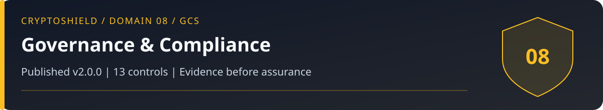

# Domain 08: Governance, Compliance, and Sovereignty (GCS)

<!-- domain-overview:start -->

   

[Home](../README.md) | [All pages](../REPOSITORY-MAP.md) | [Domains](../README.md#domains-and-control-counts) | [v2.0 changes](../FRAMEWORK-UPDATE.md) | [Machine-readable index](../metadata/repository-index.json) | [Automation guide](../AUTOMATION.md)

## Review this domain

- Apply the controls below, then record evidence in the [self-assessment](../tools/sovereignty-self-assessment.md).
- Respond using the [policy custody event playbook](../playbooks/policy-custody-event.md); read the [related research note](../research/006_pig_butchering_anatomy.md).
- Trace threat definitions in the [taxonomy](../taxonomy/README.md), cases in the [intelligence library](../intelligence/README.md), and practice in the [tabletop exercises](../tools/tabletop-exercises.md).

### Control changes in v2.0.0

NEW identifies added IDs. UPDATED identifies material revisions listed in the [framework comparison](../FRAMEWORK-UPDATE.md). RETAINED identifies an existing ID outside that material-update list; it does not mean the wording is unchanged or the control has been tested. Colors repeat the written labels.

| Control | v2.0 status |
|---|---|
| GCS-01 |  |
| GCS-02 |  |
| GCS-03 |  |
| GCS-04 |  |
| GCS-05 |  |
| GCS-06 |  |
| GCS-07 |  |
| GCS-08 |  |
| GCS-09 |  |
| GCS-10 |  |
| GCS-11 |  |
| GCS-12 |  |
| GCS-13 |  |
<!-- domain-overview:end -->

CSI CryptoSHIELD 2.0.0 | Integrity review: November 7, 2026

CSI favors self-custody and privacy. Implementation must account for applicable law, asset rights, operational capability, custody liabilities, and recovery. A policy preference or standards crosswalk does not establish legal compliance.

## Controls

| Control ID | Control | Priority |
|---|---|---|
| GCS-01 | Self-Custody First Policy | CRITICAL |
| GCS-02 | CBDC Resistance Protocol | CRITICAL |
| GCS-03 | Legal Awareness | HIGH |
| GCS-04 | Minimize identity data within applicable law | HIGH |
| GCS-05 | Vendor Sovereignty Assessment | HIGH |
| GCS-06 | Incident Response Plan | CRITICAL |
| GCS-07 | Decentralized Governance Participation | MEDIUM |
| GCS-08 | Open Source Preference | HIGH |
| GCS-09 | Privacy Tool Assessment | MEDIUM |
| GCS-10 | Annual Framework Review | HIGH |
| GCS-11 | Bounded emergency authority | CRITICAL |
| GCS-12 | Governance capture and lasting-authority review | HIGH |
| GCS-13 | Custody liabilities and asset-rights assessment | HIGH |

## Legal-source handling

GCS-01 documents custody choice, recovery competence, and exceptions. GCS-02 records CSI's opposition to surveillance-enabled currency as a policy preference. It does not establish a universal technical property of every proposed digital currency.

GCS-03 maintains a dated register of primary legal authorities, jurisdiction, covered entity and activity, effective dates, litigation status, and counsel review. Earlier claims about universal self-custody rights, AML only at CEX boundaries, categorical asset classifications, and MiCA exclusion for U.S. holders are withdrawn as operational legal guidance. Scope can depend on location, activity, counterparties, and asset rights.

For example, [FinCEN's March 2025 announcement](https://www.fincen.gov/news/news-releases/fincen-removes-beneficial-ownership-reporting-requirements-us-companies-and-us) describes an interim rule exempting U.S. companies and persons from BOI reporting, while covered foreign entities retain requirements. The prior blanket statement that all CTA reporting was suspended by court orders omitted this distinction. This example is not a complete legal-status register for November 2026.

GCS-04 minimizes collected and shared identity data within applicable requirements. Do not infer that a DEX, self-hosted wallet, or privacy tool removes legal obligations. GCS-05 examines custody contracts, segregation, liabilities, redemption, freeze and upgrade authority, insolvency priority, and insurance exclusions. A reserve snapshot does not prove solvency or cover liabilities. Fiat deposit insurance must not be described as insurance of crypto holdings.

GCS-06 references the [OODA playbook](../OODA-PLAYBOOK.md) and scenario-specific procedures. Seek qualified counsel for legal demands; jurisdiction-specific rights and obligations require current advice. Do not destroy key backups or incident evidence prematurely.

GCS-07 reviews voting power, quorum, delegation, borrowing, upgrade paths, and emergency powers. Ordinary governance participation does not itself prevent capture. Emergency powers must have bounded scope, independent authorization, expiry, audit, and restoration tests. GCS-08 prefers inspectable code but requires deployment and provenance review. GCS-09 assesses privacy tools against current law and operational risk. GCS-10 reviews evidence at least annually and after material change.

## Acceptance evidence

Record the owner, applicable sources, date, unresolved uncertainty, and implementation evidence for each decision. No standards mapping, jurisdiction label, custody score, or framework adoption establishes compliance, solvency, or safety.

## New controls in 2.0.0

### GCS-11: Bounded emergency authority

Finding: Generic timelock overrides can become unrestricted transfer or upgrade authority.

Requirement: Predefine pause/cancel powers, independent authorization, least privilege, expiry, immutable audit evidence, and restoration. Separate incident containment from ordinary upgrade and transfer authority. Inventory all bypass paths; exceptional changes require an independently reviewed procedure and explicit scope.

Acceptance: An emergency actor can perform only the intended pause/cancel actions. Arbitrary transfers, upgrades, self-extension, and removal of oversight fail. Test expiry, loss of a responder, and safe restoration.

### GCS-12: Governance capture and lasting-authority review

Finding: Temporary voting power or delegated influence may grant lasting control.

Requirement: Review quorum, voting snapshots, delegation, borrowed voting power, proposal execution, timelocks, upgrades, guardians, and role assignments as one privilege graph. Evaluate whether temporary influence can install persistent authority. Apply independent review, bounded role grants, monitoring, and cancellation to policy-defined high-risk changes.

Acceptance: Exercise a temporary voting-power scenario that attempts to install a lasting admin, module, or emergency role. Demonstrate the prevention or detection/cancellation boundary and record any residual capture path.

### GCS-13: Custody liabilities and asset-rights assessment

Finding: On-chain balances and custody labels do not establish liabilities, legal title, or redemption.

Requirement: For custodial, stablecoin, bridged, and tokenized exposures, document the holder claim, issuer/custodian obligations, segregation, liabilities, insolvency priority, redemption terms, freeze/upgrade powers, jurisdiction, and evidence date. Separate reserve attestations from a complete solvency assessment. Route unresolved legal rights to qualified review.

Acceptance: Test an omnibus-custody case, reserve/liability mismatch, issuer freeze, redemption suspension, and insolvency scenario. Missing evidence remains unknown rather than receiving a safe rating.

These are control specifications, not deployed protections. The [review and evidence backlog](../reviews/2026-11-07-baseline-integrity.md) records verification limits. Historical artwork is retired from active guidance; see the [asset register](../assets/README.md).
