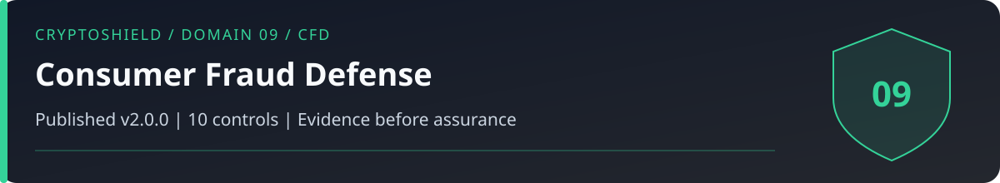

# Domain 09: Consumer Fraud and Financial Grooming Defense (CFD)

<!-- domain-overview:start -->

   

[Home](../README.md) | [All pages](../REPOSITORY-MAP.md) | [Domains](../README.md#domains-and-control-counts) | [v2.0 changes](../FRAMEWORK-UPDATE.md) | [Machine-readable index](../metadata/repository-index.json) | [Automation guide](../AUTOMATION.md)

## Review this domain

- Apply the controls below, then record evidence in the [self-assessment](../tools/sovereignty-self-assessment.md).
- Respond using the [consumer fraud playbook](../playbooks/consumer-fraud.md); read the [related research note](../research/006_pig_butchering_anatomy.md).
- Trace threat definitions in the [taxonomy](../taxonomy/README.md), cases in the [intelligence library](../intelligence/README.md), and practice in the [tabletop exercises](../tools/tabletop-exercises.md).

### Control changes in v2.0.0

NEW identifies added IDs. UPDATED identifies material revisions listed in the [framework comparison](../FRAMEWORK-UPDATE.md). RETAINED identifies an existing ID outside that material-update list; it does not mean the wording is unchanged or the control has been tested. Colors repeat the written labels.

| Control | v2.0 status |
|---|---|
| CFD-01 |  |
| CFD-02 |  |
| CFD-03 |  |
| CFD-04 |  |
| CFD-05 |  |
| CFD-06 |  |
| CFD-07 |  |
| CFD-08 |  |
| CFD-09 |  |
| CFD-10 |  |
<!-- domain-overview:end -->

CSI CryptoSHIELD 2.0.0 | Integrity review: November 7, 2026

Relationship-based investment fraud can combine fabricated profits, small successful withdrawals, impersonation, and escalating demands. Pause new payments and verify independently. A single signal warrants investigation without proving every suspected actor is fraudulent.

## Controls

| Control ID | Control | Priority |
|---|---|---|
| CFD-01 | Platform Legitimacy Stack Check | CRITICAL |
| CFD-02 | Unsolicited Investment Offer Zero Trust | CRITICAL |
| CFD-03 | Profitable Test Withdrawal Recognition | CRITICAL |
| CFD-04 | Fee Demand as Exit Signal | CRITICAL |
| CFD-05 | Bitcoin ATM Transaction Refusal | CRITICAL |
| CFD-06 | Elder Household Protocol | HIGH |
| CFD-07 | Recovery Scam Firewall | HIGH |
| CFD-08 | Independent identity verification | HIGH |
| CFD-09 | Group Chat Investment Protocol | HIGH |
| CFD-10 | Custody, liabilities, and withdrawal assessment | CRITICAL |

## Fraud checks and response

CFD-01 checks registration where required, complaints, domain history, custody terms, and independently authenticated contacts. A clean search proves only that no matching report was found. CFD-02 treats unsolicited investment introductions as unverified and pauses deposits pending independent checks.

CFD-03 recognizes that a small successful withdrawal does not establish legitimacy. The historical ten-day rule belongs to SMS-13; it is a cooling-off policy, not a fraud test. Do not send more money or sign new permissions to prove a platform works.

CFD-04 stops suspicious external payments demanded to unlock balances. Surprise taxes, AML deposits, or repeated upgrades require independent verification. Ordinary disclosed network or service fees are not by themselves proof of fraud. CFD-05 rejects unsolicited instructions to transfer funds at an ATM under claimed authority; verify through an independently obtained official contact.

CFD-06 establishes a voluntary trusted-person review process for unfamiliar transactions, respecting autonomy and consent. CFD-07 rejects unsolicited recovery promises and guaranteed outcomes. Tracing cannot itself compel seizure or reverse a finalized transfer. Lawful freezes, seizure, restitution, and voluntary return remain possible; timing and access vary.

CFD-08 authenticates identity through previously established independent channels. Video gestures and realistic voices cannot establish authenticity alone. CFD-09 examines investment claims and incentives independently of chat consensus. Group agreement alone does not prove collusion.

CFD-10 distinguishes on-chain deposits from a custodial account's contractual claim. Omnibus custody may lack a segregated user address. On-chain assets do not establish liabilities, solvency, legal title, or redemption rights. Require relevant records and terms; absence of a personal address alone is not proof of fraud.

Use the [consumer-fraud playbook](../playbooks/consumer-fraud.md). Preserve transaction hashes, chain, timestamps, destination addresses, receipts, communications, and the distinction between direct loss, affected assets, frozen funds, compensation, and recovery.

These are control specifications, not deployed protections. The [review and evidence backlog](../reviews/2026-11-07-baseline-integrity.md) records verification limits. Historical artwork is retired from active guidance; see the [asset register](../assets/README.md).
