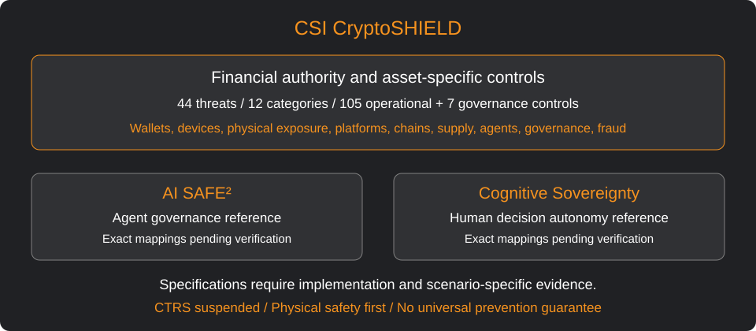

# CSI CryptoSHIELD

CryptoSHIELD specifies controls for crypto holders, developers, and protocol teams. It covers wallets and financial authority, endpoint defense, physical exposure, social platforms, on-chain activity, supply chains, agents, governance, and consumer fraud.

<!-- summary:start -->
**Integrity update, proposed version 1.2:** 44 threats across 12 categories; 95 operational controls in nine domains, plus 5 cross-domain governance controls, for 100 total. CTRS scoring is suspended. Historical scores are unvalidated and must not drive new rankings or protection claims.
<!-- summary:end -->

[Review and remaining work](reviews/2026-11-07-baseline-integrity.md) | [Threat registry](taxonomy/registry-table.md) | [Incident response](OODA-PLAYBOOK.md) | [Hardening sprint](tools/30-day-hardening-sprint.md) | [Self-assessment](tools/sovereignty-self-assessment.md)

## Start here

| Your task | Entry point |
|---|---|
| Respond to immediate physical danger | [Physical coercion](playbooks/physical-coercion.md) |
| Respond to wallet, approval, key, or device exposure | [Wallet decision tree](playbooks/wallet-compromise.md) |
| Respond to suspected investment fraud | [Consumer fraud](playbooks/consumer-fraud.md) |
| Plan holder defenses | [30-day sprint](tools/30-day-hardening-sprint.md) |
| Review protocol or agent authority | [Wallet controls](01-wallet-key-sovereignty/README.md), [agent controls](07-ai-agent-security/README.md), and [bridge boundaries](taxonomy/bridge-risk-appendix.md) |
| Contribute evidence or controls | [Contribution guide](CONTRIBUTING.md) |

## Scope and enforcement boundaries

Sovereignty first means understanding who can move, freeze, upgrade, recover, or redeem assets. Possessing a private key is only one authority path. Approvals, permits, modules, delegates, sessions, signing services, issuers, bridges, custodians, and recovery mechanisms need separate review.

This repository supplies specifications and validation tools. It does not install endpoint protection, operate a signer, or establish compliance, solvency, physical safety, or universal prevention. Default-deny policies can block or contain unapproved execution within a tested scope. Contained code may execute. Valid signatures and approved code can still cause harmful actions.

Physical safety takes priority over assets. Timelocks cover specified paths and cannot guarantee safety under coercion. Use scenario-specific response; blanket revocation and migration instructions can increase loss when keys, permits, delegates, or sweepers are involved.



## Domains and control counts

<!-- inventory:start -->
| Domain | Controls | Scope |
|---|---|---|
| [00-cross-domain](00-cross-domain/README.md) | 5 | Cross-domain governance |
| [01-wallet-key-sovereignty](01-wallet-key-sovereignty/README.md) | 10 | Operational |
| [02-endpoint-device-defense](02-endpoint-device-defense/README.md) | 10 | Operational |
| [03-opsec-physical-security](03-opsec-physical-security/README.md) | 10 | Operational |
| [04-social-media-platform-security](04-social-media-platform-security/README.md) | 15 | Operational |
| [05-on-chain-monitoring](05-on-chain-monitoring/README.md) | 10 | Operational |
| [06-supply-chain-defense](06-supply-chain-defense/README.md) | 10 | Operational |
| [07-ai-agent-security](07-ai-agent-security/README.md) | 10 | Operational |
| [08-governance-compliance-sovereignty](08-governance-compliance-sovereignty/README.md) | 10 | Operational |
| [09-consumer-fraud-defense](09-consumer-fraud-defense/README.md) | 10 | Operational |
| Total | 100 | 95 operational + 5 cross-domain |
<!-- inventory:end -->

The domain files own control definitions. The registry owns threat IDs and candidate control references. Counts, this domain summary, and the [registry table](taxonomy/registry-table.md) are generated and checked by the repository validator. A listed mitigation is not proof it prevented an incident.

## Scoring and evidence

[CTRS is suspended](taxonomy/ctrs-scoring.md) because the baseline contains incompatible component ranges, formulas, and published values. Original scores, component rows, trend claims, attribution probabilities, and case leads remain in [historical data](taxonomy/legacy/README.md) and Git history. No replacement scores or rankings are adopted.

Registry severity is inherited qualitative metadata, separate from a CTRS tier. All registry evidence remains `pending_primary_review`. A November 2026 integrity review is not a November 2026 threat-evidence cutoff. No reproducible complete incident corpus, control-effectiveness study, or calibrated attribution model is supplied.

The seven research files comprise three historical drafts under revalidation (001-003), three stubs (004-006), and one seed methodology under revalidation (007). Their [status register](research/README.md) identifies unresolved work. No research-completion, incident-count, loss-total, market-share, or prevention-percentage claim follows from their presence.

## Companion frameworks and governance

[AI SAFE²](https://github.com/CyberStrategyInstitute/ai-safe2-framework) addresses agent governance. [Cognitive Sovereignty](https://github.com/CyberStrategyInstitute/cognitive-sovereignty) addresses human decision autonomy and manipulation. The [alignment document](FRAMEWORK-ALIGNMENT.md) describes intended responsibilities and required mapping evidence. It does not certify current companion IDs, versions, control counts, or implementation behavior.

CSI favors self-custody and privacy. Policy alignment does not establish jurisdiction-specific rights or remove legal obligations. Use a dated primary-source register and qualified review for legal decisions. See [governance controls](08-governance-compliance-sovereignty/README.md).

## Repository contents

- `00-*/` through `09-*/`: control specifications.
- `taxonomy/`: active registry, generated table, suspended scoring, architecture, bridge assessment, and historical data.
- `metadata/`: separate registry and event contracts, migration guidance, and synthetic examples.
- `playbooks/` and `OODA-PLAYBOOK.md`: scenario-specific response.
- `research/`, `reviews/`, and `intelligence/`: research status, integrity findings, evidence records, and event contribution format.
- `tools/`: hardening and assessment checklists, generation and validation scripts.
- `tests/`: rejection and consistency tests for the data and documentation contracts.
- `assets/`: current SVG responsibility map and retired historical PNG artwork.

## Validate and contribute

```sh
python -m pip install -r requirements-validation.txt
python tools/validate_repository.py
python -m unittest discover -s tests -v
```

After intentional definition changes, run `python tools/generate_reference.py`, inspect the diff, and rerun validation. [CI](.github/workflows/taxonomy-lint.yml) checks every push and pull request. Validation proves contract and consistency checks pass; it does not validate historical incident claims or deployed security controls.

The prior MCP-server, handbook, card-deck, campaign, and brief dates were plans. Delivery is not established by this repository. Contribute through the [issue templates](.github/ISSUE_TEMPLATE/) and [contribution guide](CONTRIBUTING.md).

## Licensing and citation

The existing [LICENSE](LICENSE) governs: code under MIT; framework methodology, taxonomy content, and documentation under CC BY-SA 4.0. This update does not relicense existing material. Cite a specific commit and distinguish the proposed integrity update from a tagged release.

Managed by Cyber Strategy Institute. No merge, tag, release, or deployment is implied by this proposal.
